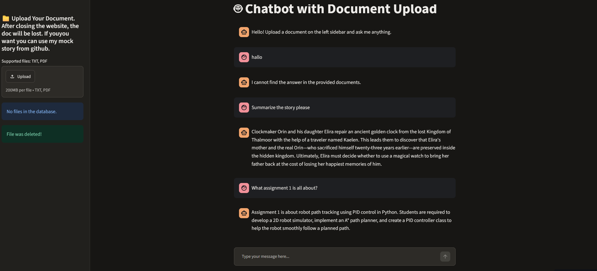

RAG Chatbot with Gemini 3.5 Flash-Lite

A powerful Retrieval-Augmented Generation (RAG) chatbot leveraging the high-throughput, low-latency Gemini 3.5 Flash-Lite model. The project orchestrates complex conversational workflows using LangGraph, handles document chunking and embeddings with LangChain, and utilizes ChromaDB as the vector database for efficient semantic search.

## 🌐 Live Demo & Status

🔗 **Live app:** https://rag-chatbot-vqswdz8kbikcvj66mrwz2h.streamlit.app/

## Warning: 
If you receive an error message indicating that the server is overloaded this means that the LLM faces too much traffic, try again later.
I use a free API Gemini key.


🚀 Features

• Fast Inference: Powered by Google's gemini-3.5-flash-lite for near-instant responses.
• Stateful Orchestration: Built with LangGraph to manage complex conversation loops and multi-step tasks.
• Persistent Vector Storage: ChromaDB handles document indexing and semantic retrieval locally.
• Production-Ready Client: Clean, object-oriented LLM initialization module using the official @google/genai SDK.
• Streamlit UI Container: Interactive, native chat interface supporting on-the-fly custom document uploads.
• Live Deployment: Hosted on Streamlit Community Cloud and actively running.
• Automated Testing: Unit tests with pytest, executed on every push via CI/CD pipelines (GitHub Actions).

🛠️ Tech Stack

• UI Interface: Streamlit
• LLM Engine: Google GenAI SDK (google-genai)
• Orchestration & Workflow: LangGraph
• Framework: LangChain
• Vector Store: ChromaDB
• Environment Management: Python Dotenv


📋 Prerequisites & Installation

1. Clone the Repository:
git clone https://github.com/GeorgiosMavropoulos/RAG-CHATBOT/
cd RAG-CHATBOT

2. Create a Virtual Environment:

python -m venv .venv
source .venv/bin/activate

3. Install Dependencies:
pip install -r requirements.txt

## 🧪 Testing & CI/CD

Tests are written with **pytest** and live in the `tests/` folder. External API calls are mocked, so the suite runs without a real API key.

```bash
pytest -v
```

On every push and pull request, a GitHub Actions workflow (`.github/workflows/ci.yml`) installs the dependencies and runs the full test suite. A failing test blocks the pipeline.

Streamlit Community Cloud redeploys the app automatically after changes are pushed to the connected branch.


4. Configuration
# GEMINI provides a free API-KEY with 15000 requests per day
Create a .env file in the root directory of your project and populate it with your credentials:

# Google Gemini Credentials
GEMINI_API_KEY="AIzaSyYourActualGoogleAIStudioKeyHere"
GEMINI_MODEL="gemini-3.5-flash-lite"
# Will work for everyone
GEMINI_API_URL="https://generativelanguage.googleapis.com" 

📦 Project Structure

├── .gitignore            # Excludes venv, .env, and cache files
├── app.py                # Main Streamlit frontend & session coordinator
├── main.py               # Main application controller & agent runner
├── llm/                  # Contains client connections and models
├── prompts/              # Prompt text files & engineering configurations
├── chroma_db/            # Local SQLite storage directory for vector index files
├── tests/                # Tests for llm call and chroma db interactios
├── requirements.txt      # Project library lockfile
└── README.md             # Project documentation


💻 Running the Application (Local)

The application currently operates entirely in your local environment and is not hosted live online. To boot up the pipeline, run the following command in your terminal:
# streamlit run app.py


⚙️ How It Works (Local Workflow)

When you initialize the application locally, the system coordinates across frontend components and backend structures:

[ User UI ] ──(Upload File)──► [ st.sidebar ] ──► (Writes Local Temp Path) ──┐
     ▲                                                                       ▼
     │                                                               [ main.py / run_ ]
(Render Response)                                                            │
     │                                                                       ▼
[ Chat Interface ] ◄──(Returns Markdown)── [ LangGraph Engine ] ◄── [ ChromaDB Vector ]
                                                   │                         Index
                                                   ▼
                                           [ Gemini 3.5 Flash ]

1. Document Upload & Temp IO: 
When a user uploads a text file (.txt) via the Streamlit sidebar, the application intercepts the stream and writes it to a safe, 
temporary location on your local machine using the Python tempfile utility.

2. Local Vector Ingestion: 
The generated path is forwarded directly to main.py.
 The ingestion engine reads the temporary path, chunks the textual content via LangChain,
  maps its structural context, and pushes the parsed vector representations to your local ./chroma_db/ folder.

3. Session Querying & RAG Strategy: 
As questions enter the chat box, Streamlit passes the query parameter down to the agent architecture.
Your vector repository retrieves semantic references locally, formats them cleanly within your RAG system,
updates context loops via LangGraph, and lets Gemini generate precise responses.

4. Delete uploaded files:
You can delete all your uploaded documents from streamlit UI.

